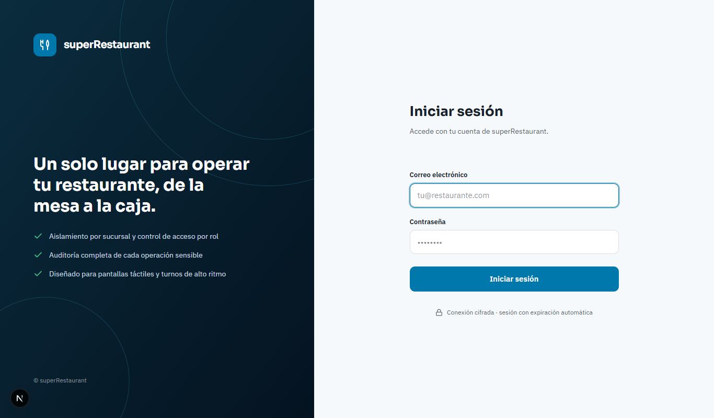
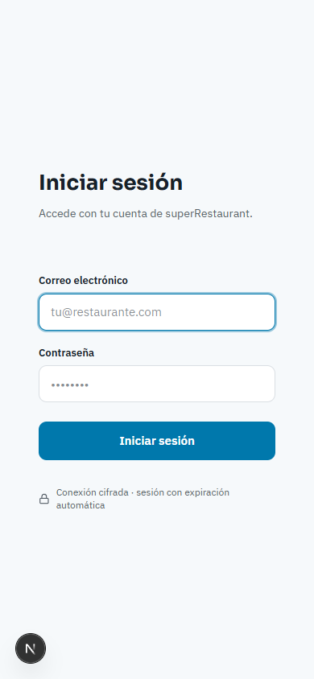

# Verificación visual · Ronda 2 (`m1-visual-verify-r2`)

- **Fecha:** 2026-11-23 (America/Phoenix)
- **Ítem de backlog:** `m1-visual-verify-r2` (Hito M1, Fase 2, Nivel C, solo lectura — sin modificaciones de código)
- **Rama:** `ao/visual-verify-r2/m1-visual-verify-r2`
- **Veredicto de verificación en navegador:** **BLOQUEADO — Ninguna de las 8 pantallas autenticadas (B2, B3, B4, Z4, Z5, K1, K2, K4) pudo abrirse ni declararse verificada en navegador real.**

> **Regla de honestidad (`WORKER_RULES.md`):** No se declara verificado en navegador nada que no se haya abierto y comprobado realmente. Toda evidencia de navegador aquí incluida corresponde únicamente al arranque real de API/web locales y al flujo público/redirección `/app/capture → /login`. Los hallazgos sobre B2, B3, B4, Z4, Z5, K1, K2 y K4 provienen exclusivamente de **auditoría estática de solo lectura** del código fuente en `main` y quedan pendientes de confirmación visual cuando se levanten ambos bloqueos.

---

## 1. Entorno levantado y bloqueos comprobados

### 1.1. Servidores locales (Node 24.19.0)
- **Runtime:** Node `v24.19.0`, pnpm `11.19.0` (activados con `. .\tools\agentic\use-node24.ps1`, según `docs/agentic/NODE.md`).
- **Compilación previa:** `@super-restaurant/domain`, `@super-restaurant/shared-types` y `@super-restaurant/api` compilados en verde.
- **API local:** `http://127.0.0.1:3004` → `GET /api/v1/health` respondió `200 {"status":"ok"}`.
- **Web local:** `http://localhost:8084` (`next dev -p 8084`, `API_BASE_URL=http://127.0.0.1:3004`, `WEB_ORIGIN=http://localhost:8084`).
- *(Nota: los puertos predeterminados `3000` y `8082` estaban ocupados por procesos previos en la máquina; se aislaron los servidores de esta sesión en `3004` y `8084` para no interferir con otras sesiones.)*

### 1.2. Bloqueo 1 · Autenticación manual requerida (total para `/app/*`)
- Toda ruta protegida (`/app/*`) exige sesión válida de Supabase Auth verificada contra `GET /api/v1/session` (`apps/web/src/proxy.ts`).
- La sesión Playwright previamente guardada en el repositorio principal (`apps/web/playwright/.auth/user.json`, fecha `2026-10-23 00:01`) está **expirada**: al navegar a `http://localhost:8084/app` con ese `storageState`, la aplicación redirige de inmediato a `/login`.
- `tools/agentic/local-servers/e2e-auth.bat` (`apps/web/e2e/save-auth.ts`) exige inicio de sesión humano interactivo en Chrome. En cumplimiento de `AGENTS.md` §3.1, no se crean/rotan credenciales ni se evaden controles de acceso.

### 1.3. Bloqueo 2 · Migraciones SQL pendientes en Supabase remoto (`zwbyiefqeujstyzysydn`)
El preflight de solo lectura (`node apps/api/dist/operations/run-migration-preflight.js`, `BEGIN TRANSACTION READ ONLY` + `ROLLBACK`) devolvió:

```json
{
  "stage": "migration_preflight",
  "lastRemote": "20261106000100",
  "localMissingInRemote": [
    "20260908000100",
    "20261120000100",
    "20261120000200",
    "20261121000100",
    "20261122000100"
  ],
  "summary": { "policies": 5, "securedTables": 50, "securityDefinerFunctions": 100 }
}
```

Impacto directo aun después de obtener login manual:
- **K1, K2 y K4:** verificables en navegador en cuanto exista sesión autenticada.
- **B2 y B3:** inspeccionables en borrador dentro de `/app/menu`, pero publicar configuración de pizza V2 fallará contra el remoto hasta aplicar `20261120000100_pizza_model_v2.sql`.
- **B4:** requiere producto con `pizzaMode` publicado en catálogo y `probe` V2 (`20261120000100`, `20261120000200`, `20261122000100`).
- **Z4 y Z5:** las pantallas cargan, pero la búsqueda de colonias SEPOMEX y el guardado/emparejamiento por `settlementId` fallarán hasta aplicar `20261121000100_delivery_zones_settlements.sql`.

---

## 2. Evidencia capturada en navegador real (alcance público / redirección)

Se ejecutó Playwright (Chrome real) navegando a `/app/capture` en escritorio (`1366×800`) y móvil (`390×844`) contra `http://localhost:8084` + API `127.0.0.1:3004`:

| Viewport | Ruta solicitada → final | Consola / `pageerror` | `alert`/`confirm`/`prompt` | Overflow X | Targets < 44 px | Foco tras `Tab` | Captura |
|---|---|---|---|---|---|---|---|
| Escritorio `1366×800` | `/app/capture` → `/login` (HTTP 200) | 0 errores / 0 `pageerror` | 0 diálogos nativos | No (`false`) | 0 de 4 controles | Visible en input «Correo electrónico» (borde/anillo azul) | [login-redirect-desktop-1366x800.png](visual-verify-r2-captures/login-redirect-desktop-1366x800.png) |
| Móvil `390×844` | `/app/capture` → `/login` (HTTP 200) | 0 errores / 0 `pageerror` | 0 diálogos nativos | No (`false`) | 0 de 4 controles | Visible en input «Correo electrónico» (borde/anillo azul) | [login-redirect-mobile-390x844.png](visual-verify-r2-captures/login-redirect-mobile-390x844.png) |





---

## 3. Matriz de estado de las 8 pantallas objetivo

Ninguna de las 8 pantallas pudo abrirse autenticada en navegador real; todas permanecen **NO VERIFICADAS** hasta contar con sesión humana (y migraciones remotas para B2 publicación, B4, Z4 y Z5).

| Pantalla | Ruta objetivo | Escritorio `1366×800` | Móvil `390×844` | Motivo de no verificación en navegador |
|---|---|---|---|---|
| **B2** · Editor de pizza V2 | `/app/menu` | **NO VERIFICADA** | **NO VERIFICADA** | Bloqueo 1 (sin login). Además, publicar requiere migración `20261120000100`. |
| **B3** · Tiles de opciones (`OptionCheckTile`) | `/app/menu`, `/app/capture` | **NO VERIFICADA** | **NO VERIFICADA** | Bloqueo 1 (sin login). En captura depende también de B4 (`20261120000100`). |
| **B4** · Captura de pizza V2 (hoja de producto) | `/app/capture` | **NO VERIFICADA** | **NO VERIFICADA** | Bloqueo 1 (sin login) + Bloqueo 2 (`20261120000100`, `20261120000200`, `20261122000100` sin aplicar en remoto). |
| **Z4** · Editor de zonas por colonia | `/app/delivery-zones` | **NO VERIFICADA** | **NO VERIFICADA** | Bloqueo 1 (sin login) + Bloqueo 2 (`20261121000100` sin aplicar en remoto). |
| **Z5** · Formulario de dirección con colonia y motivo | `/app/customers`, `/app/capture` | **NO VERIFICADA** | **NO VERIFICADA** | Bloqueo 1 (sin login) + Bloqueo 2 (`20261121000100` sin aplicar en remoto). |
| **K1** · Portada de captura cliente-primero | `/app/capture` | **NO VERIFICADA** | **NO VERIFICADA** | Bloqueo 1 (sin login). |
| **K2** · Atajos globales (`Alt+N`, `Alt+Shift+R`, `Escape`) | `/app/*`, `/app/capture` | **NO VERIFICADA** | **NO VERIFICADA** | Bloqueo 1 (sin login). |
| **K4** · Quitar teléfono con confirmación in-app | `/app/customers` | **NO VERIFICADA** | **NO VERIFICADA** | Bloqueo 1 (sin login). |

---

## 4. Hallazgos de auditoría estática de solo lectura (P1 / P2)

> **Alcance:** Inspección directa del código fuente en `apps/web/src/**` sin editar archivos. Como las pantallas autenticadas no pudieron abrirse en navegador, cada hallazgo cita su ruta exacta (`archivo:línea`) y enlaza la captura de evidencia del bloqueo de acceso (`visual-verify-r2-captures/login-redirect-desktop-1366x800.png`) donde corresponde; todos requieren confirmación visual tras desbloquear el login.

### Resumen de comprobaciones estáticas transversales
- **`alert()` / `confirm()` / `prompt()` nativos:** **0 usos** en todo `apps/web/src/**` (búsqueda recursiva sobre `.ts`/`.tsx`; única coincidencia textual fue el callback local `confirm()` en `apps/web/src/app/app/menu/photo-crop-dialog.tsx:195`).
- **Tokens de contraste (`apps/web/src/app/globals.css` y `apps/web/src/lib/ui-classes.ts`):** `uiButton` / `uiOption` definen variantes completas sin colisión de utilidades Tailwind (`text` sobre `surface`, blanco sobre `accent` OKLCH 53 %, `error` sobre `surface`), con la excepción puntual de **P2-4** en `OptionCheckTile`.

### P1 (críticos)
- No se detectaron hallazgos P1 en la inspección estática (los bloqueos de entorno 1 y 2 impiden aún descartar regresiones runtime P1 en navegador).

### P2 (funcionales / accesibilidad relevantes)

1. **P2-1 · Z5 — `matchDeliveryAddress` omite `settlementId` y `neighborhood` en Directorio y Captura**
   - **Rutas:** `apps/web/src/app/app/customers/customer-editor.tsx:152-153` y `apps/web/src/app/app/capture/capture-workspace.tsx:244-245` (comparar con `apps/web/src/app/app/capture/capture-customer.tsx:107-114`, que sí envía los 5 campos).
   - **Evidencia de captura:** Pendiente de captura de pantalla autenticada (bloqueada por login: [login-redirect-desktop-1366x800.png](visual-verify-r2-captures/login-redirect-desktop-1366x800.png)).
   - **Detalle:** Al pulsar «Validar para esta sucursal» en `/app/customers` y al consultar la cobertura informativa del `fulfillmentSnapshot` en `/app/capture`, ambos llamadores envían solo `{ postalCode, locality }` y descartan `settlementId`, `neighborhood` y `settlementOutsideCatalog`. Para zonas configuradas exclusivamente por colonia (Z4), la consulta informativa no coincide por asentamiento y puede reportar `not_covered` o caer al respaldo por CP.

2. **P2-2 · K2 — `Alt+N` global no advierte sobre cambios sin guardar en Menú, Zonas ni Perfil de cliente**
   - **Rutas:** `apps/web/src/app/app/global-shortcuts.tsx:41`, `apps/web/src/lib/unsaved-changes.ts:5-10`, `apps/web/src/app/app/menu/menu-catalog-editor.tsx`, `apps/web/src/app/app/delivery-zones/delivery-zones-editor.tsx`, `apps/web/src/app/app/customers/customer-editor.tsx:370-416`.
   - **Evidencia de captura:** Pendiente de captura de pantalla autenticada (bloqueada por login: [login-redirect-desktop-1366x800.png](visual-verify-r2-captures/login-redirect-desktop-1366x800.png)).
   - **Detalle:** `setUnsavedChanges(...)` solo se invoca desde `AddressForm` (`customer-editor.tsx:448`) y `dining-zone.tsx:100`. Si el operador edita un producto en `/app/menu`, una zona en `/app/delivery-zones` o el perfil/teléfonos en `/app/customers` y pulsa `Alt+N`, `GlobalShortcuts` navega de inmediato a `/app/capture?focus=customer` sin mostrar el modal «Hay cambios sin guardar».

3. **P2-3 · K2 — `Escape` en `CaptureCustomerSearch` consume la primera pulsación cuando el desplegable no es visible**
   - **Ruta:** `apps/web/src/app/app/capture/capture-customer-search.tsx:74, 103-106`.
   - **Evidencia de captura:** Pendiente de captura de pantalla autenticada (bloqueada por login: [login-redirect-desktop-1366x800.png](visual-verify-r2-captures/login-redirect-desktop-1366x800.png)).
   - **Detalle:** Al enfocar el buscador de cliente, `open` pasa a `true` aunque `optionCount === 0` (`listVisible === false`). En `onKeyDown`, la condición `if (open) { event.preventDefault(); close(); }` intercepta `Escape` incluso cuando no hay ningún listbox visible, impidiendo que la primera pulsación quite el foco (`blur()`) o cierre una capa externa en `capture-workspace.tsx:1107-1131`. Debe comprobar `listVisible` en lugar de `open`.

4. **P2-4 · B3 — Foco de teclado no resaltado en el contenedor `OptionCheckTile` y contraste del checkbox seleccionado**
   - **Ruta:** `apps/web/src/app/app/menu/option-check-tile.tsx:25-27`.
   - **Evidencia de captura:** Pendiente de captura de pantalla autenticada (bloqueada por login: [login-redirect-desktop-1366x800.png](visual-verify-r2-captures/login-redirect-desktop-1366x800.png)).
   - **Detalle:** `uiOption(checked, ...)` coloca `focus-visible:outline-2 focus-visible:outline-offset-2 focus-visible:outline-accent` en el elemento `<label>` (que no recibe foco de teclado), mientras que el `<input type="checkbox">` solo declara `size-5 shrink-0 accent-accent` (sin `focus-visible` propio ni `has-[:focus-visible]:outline-*` en el tile). Además, cuando `checked === true`, el tile usa `bg-accent` detrás del checkbox con `accent-accent`, lo que puede reducir el contraste del recuadro marcado en Chrome.

5. **P2-5 · K1 / Z5 — Enlace «Abrir el cliente en Directorio» por debajo de 44 px y sin `focus-visible` explícito**
   - **Ruta:** `apps/web/src/app/app/capture/capture-customer.tsx:201`.
   - **Evidencia de captura:** Pendiente de captura de pantalla autenticada (bloqueada por login: [login-redirect-mobile-390x844.png](visual-verify-r2-captures/login-redirect-mobile-390x844.png)).
   - **Detalle:** `<a href="/app/customers?customerId=..." className="mt-3 block text-sm text-accent underline">` tiene ~20 px de altura táctil (por debajo del mínimo de 44 px / `min-h-11`), carece de `focus-visible:outline-*` explícito y usa `<a>` en lugar de `next/link`, provocando recarga completa.

### P3 (deuda menor)
Los 3 hallazgos P3 detectados en esta revisión quedaron registrados en [docs/agentic/debt.md](debt.md) bajo `m1-visual-verify-r2`:
- `delivery-zones-editor.tsx:211, 232` (Z4): chips de colonias y `<summary>` sin `focus-visible:outline-*` explícito; colonias guardadas mostradas por `Colonia <id8>`.
- `customer-editor.tsx:32` (Z5): mensaje de error `messages.invalid` aún menciona localidad y país (ocultos por Z5).
- `global-shortcuts.tsx:61-76` y `capture-workspace.tsx:1102-1142, 1406-1421` (K2): modales sin trampa de foco `Tab` ni retorno de foco al disparador; `useEffect` de atajos sin arreglo de dependencias.

---

## 5. Pasos para cerrar la verificación visual real

1. **Aplicar las 4 migraciones pendientes en Supabase remoto** (previa aprobación humana explícita y siguiendo `docs/runbooks/migration-apply.md`):
   - `20261120000100_pizza_model_v2.sql`
   - `20261120000200_capture_selection_plan_probe_v2.sql`
   - `20261121000100_delivery_zones_settlements.sql`
   - `20261122000100_fix_confirm_capture_pizza_v2.sql`
2. **Renovar sesión Playwright** ejecutando `tools/agentic/local-servers/e2e-auth.bat` con API y web locales levantados (sucursal Navojoa).
3. **Re-ejecutar esta verificación** en escritorio (`1366×800`) y móvil (`390×844`) sobre B2, B3, B4, Z4, Z5, K1, K2 y K4, adjuntando capturas reales de cada pantalla y confirmando/actualizando los 5 hallazgos P2 anteriores.
