# Verificación visual · Ronda 3 (`tarea-1.3` · puesto operativo web y KDS)

- **Fecha:** 2026-11-23 (America/Phoenix)
- **Tarea:** TAREA 1.3 (`agy`, Nivel C, verificación visual en navegador real — sin modificaciones de código fuente ni SQL)
- **Rama local:** `ao/visual-verify/visual-verify-r3` (sobre `8e17acdd` / `main`)
- **Alcance verificado en navegador real (Playwright + Chrome instalado):**
  1. **Captura** (`/app/capture` — portada cliente-primero, reanudación por deep link `?draftId=`, hoja de armado de pizza mitad y mitad)
  2. **Clientes** (`/app/customers` — ficha completa, teléfonos, confirmación in-app K4, dirección con colonia SEPOMEX Z5, historial reciente y capturas abiertas K3)
  3. **Entregas** (`/app/deliveries` — tablero operativo de gerente/cajero y vista restringida de rol `courier`)
  4. **KDS** (`apps/kds` — pantalla de acceso, tablero en vivo con WebSocket Socket.IO, comandas con mitades/notas y transición de lote)
- **Veredicto:** **VERIFICADO EN NAVEGADOR REAL CON HALLAZGOS ABIERTOS (2 P1, 6 P2, 4 P3).** Todas las 4 superficies se abrieron autenticadas y con datos reales en escritorio (`1366×800`) y móvil (`390×844`) contra PostgreSQL 17 + API + Auth 100 % locales (cero uso de Supabase remoto). Se detectaron **2 bloqueantes P1** que impiden declarar las pantallas limpias hasta corregirse.

---

## 1. Entorno local levantado (0 % remoto)

- **Runtime:** Node `v24.19.0`, pnpm `11.19.0` (`C:\Users\Emmanuel G\AppData\Local\Programs\node24`), Chrome instalado (`C:\Program Files\Google\Chrome\Application\chrome.exe`) vía Playwright `channel: "chrome"`.
- **PostgreSQL 17.6 local desechable:** instancia temporal en `%TEMP%\sr-visual-verify-r3\pgdata` (`127.0.0.1:54775`), aplicando las **74 migraciones SQL** de `supabase/migrations/` desde cero (incluidas `20261120000100`–`20261123000300` y los 568 asentamientos SEPOMEX de Navojoa).
- **Auth local de pruebas:** servidor HTTPS efímero compatible con GoTrue (`https://127.0.0.1:54329`, CA temporal en `%TEMP%` cargada vía `NODE_EXTRA_CA_CERTS`) con 3 usuarios sembrados en `auth.users` y `app.memberships`:
  - `operador@vittorinos.local` (`owner`, `manager`, `cashier`)
  - `repartidor@vittorinos.local` (`courier`)
  - `mesero@vittorinos.local` (`waiter`)
- **Servidores locales:**
  - API NestJS: `http://127.0.0.1:3013` (`NODE_ENV=test`, `SR_TEST_DATABASE_URL` como rol `app_api`, `GET /api/v1/health` → `200`)
  - Web Next.js 16.3.3: `http://127.0.0.1:8093`
  - KDS Vite 8.2.2: `http://127.0.0.1:4174` (proxy `/api` y `/socket.io` → `http://127.0.0.1:3013`)
- **Datos seed creados por la propia API local:** restaurante `Vittorinos Pizzeria` / sucursal `Navojoa Centro` (`America/Hermosillo`), catálogo publicado (3 categorías, 6 productos, tamaños `Mediana`/`Grande` y `Pizza Clásica` con mitades/ingredientes), zona `Centro Navojoa` con colonia SEPOMEX `Estadio Viejo` (`85800`, envío `$35.00`), turno `Turno Matutino`, caja abierta (`$1,000.00`), 3 clientes con teléfonos y direcciones validadas (`Ana López Martínez`, `Roberto Mendoza`, `Sofía Ramírez`), 1 borrador en espera (`heldDraft`) para Ana y 4 órdenes confirmadas enviadas a cocina (`Por asignar`, `En ruta`, `Entregada por liquidar` y `Mostrador` con ítems en `sent` y `preparing`).
- **Limpieza:** todos los servidores y PG17 cerraron limpiamente al terminar (`postgres.exe exited code=0`).

---

## 2. Matriz de resultados por pantalla y viewport

| Superficie | Viewport | Consola (`error` / `pageerror`) | Red (`requestfailed` / HTTP ≥400 navegador) | Diálogos nativos (`alert`/`confirm`/`prompt`) | Overflow X (`scrollWidth / innerWidth`) | Controles `< 44 px` | Foco `Tab` visible | Capturas |
|---|---|---:|---:|---:|---|---:|---|---|
| **Captura · Portada** (`/app/capture`) | `1366×800` | `0 / 0` | `0 / 0` | `0` | No (`1366/1366`) | 4 (`FieldHint ?` `20×20`) | Sí (`2px solid #fff` en nav) | [capture-landing-desktop.png](visual-verify-r3/capture-landing-desktop.png) |
| **Captura · Portada** (`/app/capture`) | `390×844` | `0 / 0` | `0 / 0` | `0` | **Sí (`433/390`) — P1-2** | 7 (6 `?` `20×20`, 1 checkbox `20×20`) | Sí (`2px solid #fff`) | [capture-landing-mobile.png](visual-verify-r3/capture-landing-mobile.png) |
| **Captura · Borrador activo** (`/app/capture?draftId=…`) | `1366×800` | `0 / 0` | `0 / 0` *(API SSR 503 en historial — P1-1)* | `0` | No (`1366/1366`) | 12 (8 `?`, `<a>` `20 px`, `−`/`+` `40×40`, checkbox) | Sí | [capture-active-desktop.png](visual-verify-r3/capture-active-desktop.png) |
| **Captura · Borrador activo** (`/app/capture?draftId=…`) | `390×844` | `0 / 0` | `0 / 0` | `0` | No (`390/390`) | 4 (`FieldHint ?` `20×20`) | Sí | [capture-active-mobile.png](visual-verify-r3/capture-active-mobile.png) |
| **Captura · Hoja producto / Mitades** | `1366×800` | `0 / 0` | `0 / 0` | `0` | No (`1366/1366`) | 13 (mismos del fondo + `?`) | Sí | [capture-sheet-desktop.png](visual-verify-r3/capture-sheet-desktop.png) |
| **Captura · Hoja producto / Mitades** | `390×844` | `0 / 0` | `0 / 0` | `0` | No (`390/390`) | 5 (`FieldHint ?` `20×20`) | Sí | [capture-sheet-mobile.png](visual-verify-r3/capture-sheet-mobile.png) |
| **Clientes** (`/app/customers?customerId=…`) | `1366×800` | `0 / 0` | `0 / 0` *(API SSR **503** en historial — P1-1)* | `0` | No (`1366/1366`) | 15 (`FieldHint ?` `20×20`) | Sí (`2px solid #fff`) | [customers-desktop.png](visual-verify-r3/customers-desktop.png), [customers-k4-dialog-desktop.png](visual-verify-r3/customers-k4-dialog-desktop.png) |
| **Clientes** (`/app/customers?customerId=…`) | `390×844` | `0 / 0` | `0 / 0` *(API SSR **503** en historial — P1-1)* | `0` | No (`390/390`) | 15 (`FieldHint ?` `20×20`) | Sí (`2px solid #fff`) | [customers-mobile.png](visual-verify-r3/customers-mobile.png) |
| **Entregas · Gerente** (`/app/deliveries`) | `1366×800` | `0 / 0` | `0 / 0` | `0` | No (`1366/1366`) | **0** de 15 | Sí (`2px solid #fff`) | [deliveries-desktop.png](visual-verify-r3/deliveries-desktop.png) |
| **Entregas · Gerente** (`/app/deliveries`) | `390×844` | `0 / 0` | `0 / 0` | `0` | No (`390/390`) | **0** de 11 | Sí (`2px solid #fff`) | [deliveries-mobile.png](visual-verify-r3/deliveries-mobile.png) |
| **Entregas · Repartidor (`courier`)** | `1366×800` | `0 / 0` | `0 / 0` | `0` | No (`1366/1366`) | **0** de 14 | Sí | [deliveries-courier-desktop.png](visual-verify-r3/deliveries-courier-desktop.png) |
| **Entregas · Repartidor (`courier`)** | `390×844` | `0 / 0` | `0 / 0` | `0` | No (`390/390`) | **0** de 11 | Sí | [deliveries-courier-mobile.png](visual-verify-r3/deliveries-courier-mobile.png) |
| **KDS** (`http://127.0.0.1:4174/`) | `1366×800` | **`1` (404 favicon — P2-5) / `0`** | `0 / 0` *(1 aviso WS en dev — P3-1)* | `0` | No (`1366/1366`) | **0** de 17 | Sí (`3px solid #f6c453` en `<select>`) | [kds-login-desktop.png](visual-verify-r3/kds-login-desktop.png), [kds-board-desktop.png](visual-verify-r3/kds-board-desktop.png), [kds-transition-desktop.png](visual-verify-r3/kds-transition-desktop.png) |
| **KDS** (`http://127.0.0.1:4174/`) | `390×844` | `0 / 0` | `0 / 0` *(1 aviso WS en dev — P3-1)* | `0` | No (`390/390`) | **0** de 17 | Sí (`3px solid #f6c453`) | [kds-board-mobile.png](visual-verify-r3/kds-board-mobile.png) |

---

## 3. Hallazgos P1 (Críticos)

### P1-1 · Clientes y Captura — `GET /api/v1/customers/:customerId/orders/recent` devuelve HTTP 503 cuando el cliente tiene pedidos con mitades / Pizza V2
- **Pantallas afectadas:** `/app/customers` («Historial reciente») y `/app/capture` («Pedidos recientes»), en escritorio (`1366×800`) y móvil (`390×844`).
- **Síntoma observado en navegador:** En `/app/customers?customerId=<ana>` aparece el aviso `role="alert"` rojo **«No se pudo cargar el historial.»** con botón «Reintentar» ([customers-desktop.png](visual-verify-r3/customers-desktop.png), [customers-mobile.png](visual-verify-r3/customers-mobile.png)); en `/app/capture`, el bloque «Pedidos recientes» no logra poblarse tras el `503` del servidor (3 respuestas `HTTP 503` registradas en el log del API local para `GET /api/v1/customers/:customerId/orders/recent`).
- **Causa raíz verificada en código:**
  - Las órdenes confirmadas con pizza mitad y mitad (o Pizza V2) persisten modificadores sintéticos con `modifierId` compuesto (p. ej. `extra:half-a:<uuid>`, `exclude:half-b:<uuid>`) y `groupId` simbólico (`fraction-exclusion`, `pizza-extra`, `pizza-ingredient`).
  - `PostgresCustomerOrderHistory.readInternal` (`apps/api/src/customer-order-history.ts:122-123`) decodifica la orden y valida el listado con `parseCustomerRecentOrderListV1`.
  - `parseModifier` en `packages/shared-types/src/customer-order-history.ts:413-415` exige UUID estricto para `groupId` (`uuid(rawGroupId)`) y `modifierId` (`uuid(own(record, "modifierId"))`). Al fallar la validación, `internalList(...)` devuelve `undefined` y la API responde `503 Service Unavailable`.
  - El mismo `readInternal()` respalda `repeat-preview` (`apps/api/src/customer-order-history.ts:100`), por lo que también bloquea «Repetir pedido» para cualquier cliente que haya pedido una pizza por mitades.
- **Corrección sugerida (nivel A/B):** Admitir/proyectar los modificadores sintéticos de mitades/Pizza V2 en el contrato de historial reciente (o separarlos de los UUID de catálogo) y agregar prueba en `customer-order-history.test.ts` + `http-flow.local.test.ts`.

### P1-2 · Captura móvil (`390×844`) — Desborde horizontal (`433 px` sobre `390 px`) en «Apropiación supervisada»
- **Pantalla afectada:** `/app/capture` en portada móvil (`390×844`).
- **Síntoma observado en navegador:** `scrollWidth = 433 px` vs `innerWidth = 390 px` (`overflowX: true`). Como se ve en [capture-landing-mobile.png](visual-verify-r3/capture-landing-mobile.png), el `<select id="capture-takeover-draft">` se sale por el borde derecho de su tarjeta y arrastra consigo el `<textarea id="capture-takeover-reason">` y el botón **«Tomar control de la captura»** (`left: 33, right: 433`).
- **Causa raíz verificada en código:** `apps/web/src/app/app/capture/capture-workspace.tsx:1300-1306` coloca el `<select>` dentro de un `grid` sin `min-w-0`/`max-w-full` y sus `<option>` pintan el folio completo con UUID (`C-fe59ec51-7fa8-44ad-a424-c0310fc63543 · versión 7`), forzando un `min-content` superior al ancho móvil de `390 px`.
- **Corrección sugerida (nivel C):** Añadir `min-w-0` al wrapper de `Field`/grid y `max-w-full truncate` al `<select>`, además de mostrar un folio corto o nombre de cliente en la etiqueta de `<option>`.

---

## 4. Hallazgos P2 (Funcionales, UX y accesibilidad)

1. **P2-1 · Captura — Confirmado en vivo que `matchDeliveryAddress` omite `settlementId` y `neighborhood` (r2 P2-1) y muestra doble punto**
   - **Evidencia:** En [capture-active-desktop.png](visual-verify-r3/capture-active-desktop.png), pese a que la dirección de Ana tiene `settlementId` válido (`Estadio Viejo`, CP `85800`) y la zona `Centro Navojoa` lo cubre expresamente, la tarjeta «Entrega · cotización» muestra: *«Zona Centro Navojoa · Envío $35.00 · 30–45 min. No se reconoció la colonia; se usó el código postal como respaldo. Actualiza la dirección.. Consulta informativa; cotiza para confirmar.»* El log de Next.js confirma la llamada con sólo `{ locality: "Navojoa", postalCode: "85800" }`.
   - **Rutas:** `apps/web/src/app/app/capture/capture-workspace.tsx:244-245` y `apps/web/src/app/app/customers/customer-editor.tsx:152-153` (además del doble punto `"Actualiza la dirección.."` en el formateador).

2. **P2-2 · Captura y Clientes — Objetivos táctiles `< 44 px` confirmados en navegador real (`AGENTS.md §14/§19.2`)**
   - **Evidencia (`diagnostics.json` + [capture-active-desktop.png](visual-verify-r3/capture-active-desktop.png)):**
     - Enlace **«Abrir el cliente en Directorio»** (`apps/web/src/app/app/capture/capture-customer.tsx:201`): **`1002×20 px`** (confirma P2-5 de r2; también usa `<a>` en lugar de `next/link`).
     - Botones de cantidad **`−` y `+`** del ticket en Captura: **`40×40 px`** (4 px debajo del mínimo táctil de `44×44 px`).
     - Botones de ayuda **`?`** (`FieldHint`) en Captura y Clientes: **`20×20 px`** (4 a 15 instancias por pantalla).

3. **P2-3 · KDS — Las tarjetas de pedidos no muestran folio corto ni identificador de orden/cliente**
   - **Evidencia:** En [kds-board-desktop.png](visual-verify-r3/kds-board-desktop.png) y [kds-board-mobile.png](visual-verify-r3/kds-board-mobile.png), las tres tarjetas de domicilio muestran exactamente el mismo encabezado (`Entrega · 2 min · Llegó 09:35 a.m.`), sin folio corto (8 caracteres) ni etiqueta de cuenta/mesa/cliente para que cocina y empaque diferencien pedidos simultáneos del mismo canal.
   - **Ruta:** `apps/kds/src/App.tsx`.

4. **P2-4 · Entregas vista repartidor (`courier`) — La barra lateral muestra 7 secciones no autorizadas para el rol**
   - **Evidencia:** En [deliveries-courier-desktop.png](visual-verify-r3/deliveries-courier-desktop.png), con sesión de `repartidor@vittorinos.local` (rol exclusivo `courier`), el contenido de `/app/deliveries` respeta el aislamiento de rol (solo muestra sus entregas `En ruta` y `Entregadas por liquidar`, con `Ver pedido` y sin `Por asignar` ni `Liquidar`), pero el menú lateral sigue listando `Mesas`, `Menú`, `Caja`, `Órdenes`, `Clientes`, `Captura` y `Zonas`.
   - **Ruta:** `apps/web/src/app/app/app-nav.tsx`.

5. **P2-5 · KDS escritorio — Error de consola `404 Not Found` por ausencia de favicon**
   - **Evidencia:** `kdsDiagnostics.consoleErrors` registró `"Failed to load resource: the server responded with a status of 404 (Not Found)"` al abrir `http://127.0.0.1:4174/` en escritorio porque `apps/kds/index.html` no declara `<link rel="icon">` ni existe `favicon.ico`, rompiendo la puerta de cero errores de consola.

6. **P2-6 · Clientes — Etiquetas habituales de teléfono («Celular», «Casa») se muestran como «Otro» + campo extra**
   - **Evidencia:** En [customers-desktop.png](visual-verify-r3/customers-desktop.png) y [customers-mobile.png](visual-verify-r3/customers-mobile.png), `customer-editor.tsx:30` limita `phoneLabels` a `["Principal", "Secundario", "Trabajo"]`; los teléfonos guardados como `"Celular"` o `"Casa"` abren el `<select>` en `"Otro"` y despliegan un input adicional `"Otra etiqueta"`, alargando el formulario en móvil.

---

## 5. Observaciones P3 (menores / entorno de desarrollo)

- **P3-1 · KDS (aviso WebSocket en `dev`):** En ambos viewports apareció un `console.warning` (`WebSocket connection to 'ws://127.0.0.1:4174/socket.io/?EIO=4&transport=websocket' failed: WebSocket is closed before the connection is established.`) provocado por el doble montaje de `<StrictMode>` (`apps/kds/src/main.tsx:17`); el segundo montaje conecta inmediatamente (`En vivo · kitchen`) y las transiciones funcionan en tiempo real ([kds-transition-desktop.png](visual-verify-r3/kds-transition-desktop.png)).
- **P3-2 · Web (aviso de `@supabase/ssr` en `dev`):** La consola recibe el warning informativo de Supabase sobre `getSession()` tras `getUser()` (sin impacto de seguridad porque `proxy.ts` valida antes con `getUser()` y `GET /api/v1/session`).
- **P3-3 · Clientes K3 («Capturas abiertas»):** Muestra el folio completo con UUID (`C-fe59ec51-7fa8-44ad-a424-c0310fc63543`) en lugar de un folio abreviado; en `390×844` envuelve en dos líneas sin causar overflow.
- **P3-4 · Hoja de producto móvil en `next dev`:** En [capture-sheet-mobile.png](visual-verify-r3/capture-sheet-mobile.png), la insignia flotante `N` de Next.js Dev Tools se superpone sobre el botón `−` (artefacto exclusivo de desarrollo, ausente en build de producción).

---

## 6. Evidencia visual capturada

### 6.1. Captura (`/app/capture`)
- **Validado positivamente:** portada cliente-primero (K1), listado de «Borradores recuperables» con nombre/teléfono/importe (`$187.50`), deep link `?draftId=` sin auto-claim y botón explícito «Retomar», hoja de producto con modo «Mitad y mitad» y desglose en ticket (`Mitad A: Pepperoni + Queso Extra`, `Mitad B: Hawaiana · Sin Cebolla`, `Nota: Bien dorada`), paso 4 «Cobro» con botones rápidos y propina separada.

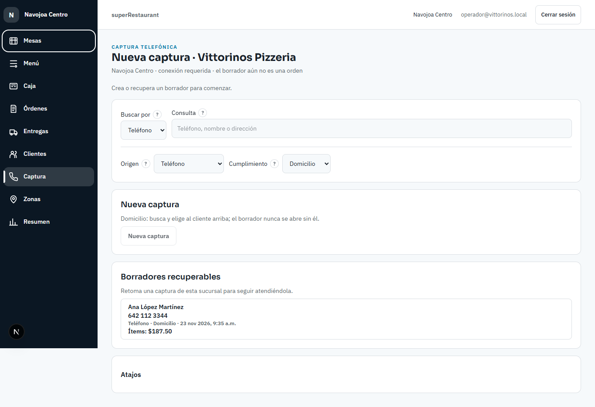

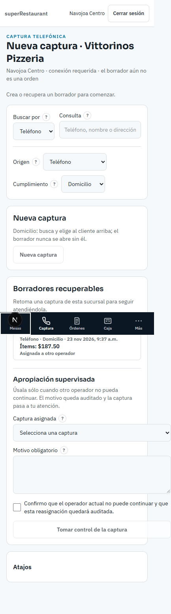

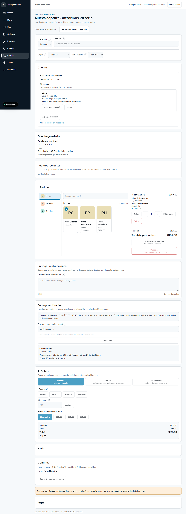

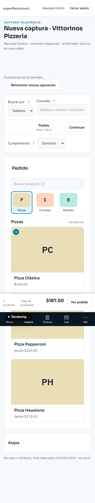

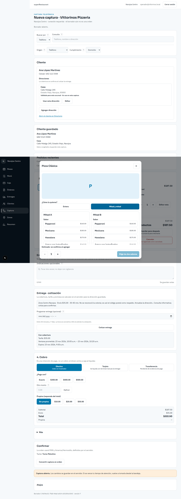

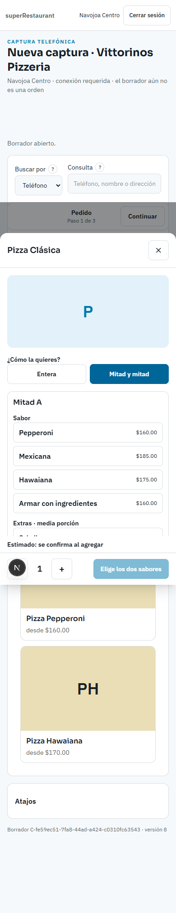

### 6.2. Clientes (`/app/customers`)
- **Validado positivamente:** carga por `?customerId=`, ficha con teléfonos y diálogo in-app **K4** «Quitar teléfono» (sin `confirm()` nativo), dirección validada con colonia SEPOMEX (`Estadio Viejo`, CP `85800`, botón «Mi colonia no está en la lista» Z5) y tarjeta **K3** «Capturas abiertas» con botón «Retomar».
- **Bloqueante:** «Historial reciente» muestra el error de **P1-1**.

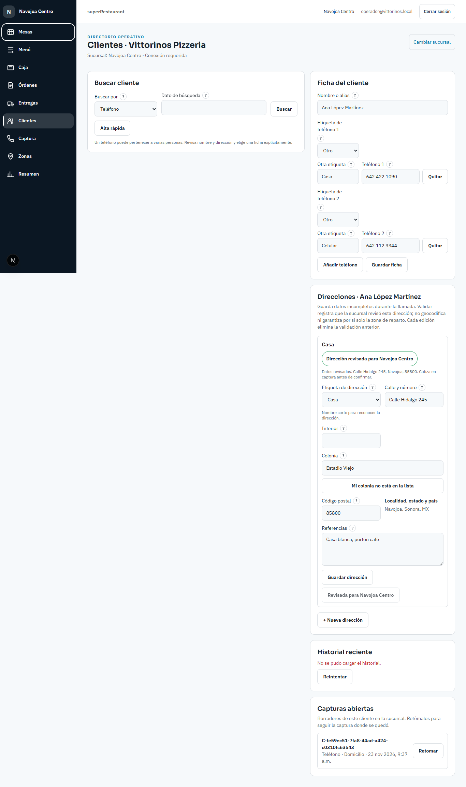

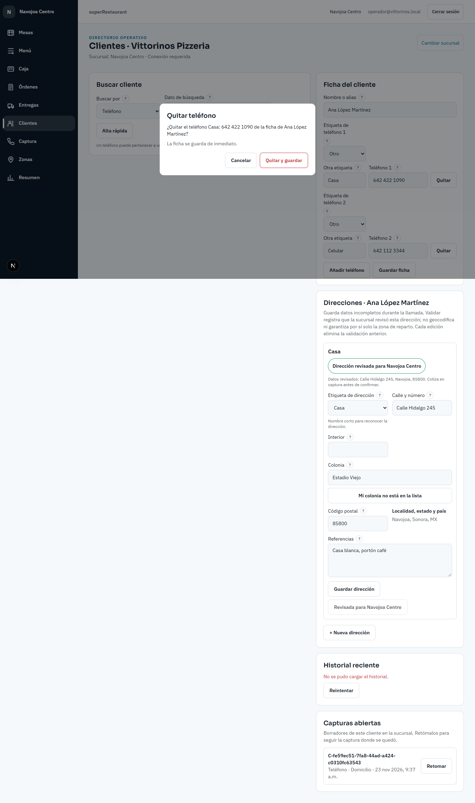

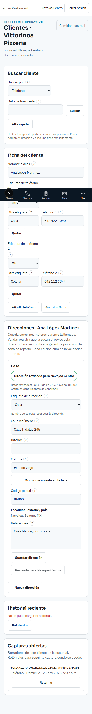

### 6.3. Entregas (`/app/deliveries`)
- **Validado positivamente:** tablero impecable en escritorio (`1366×800`) y móvil (`390×844`), **0 errores de consola/red, 0 overflow X y 0 controles `< 44 px`** tanto en vista gerente/cajero («Por asignar» con `CR · Carlos Repartidor`, «En ruta», «Entregadas por liquidar» con «Liquidar», «Fallidas») como en vista restringida de `courier` (solo sus entregas, «Ver pedido», «Entregada», «No se pudo» y texto «Pendiente de liquidar en caja.»).

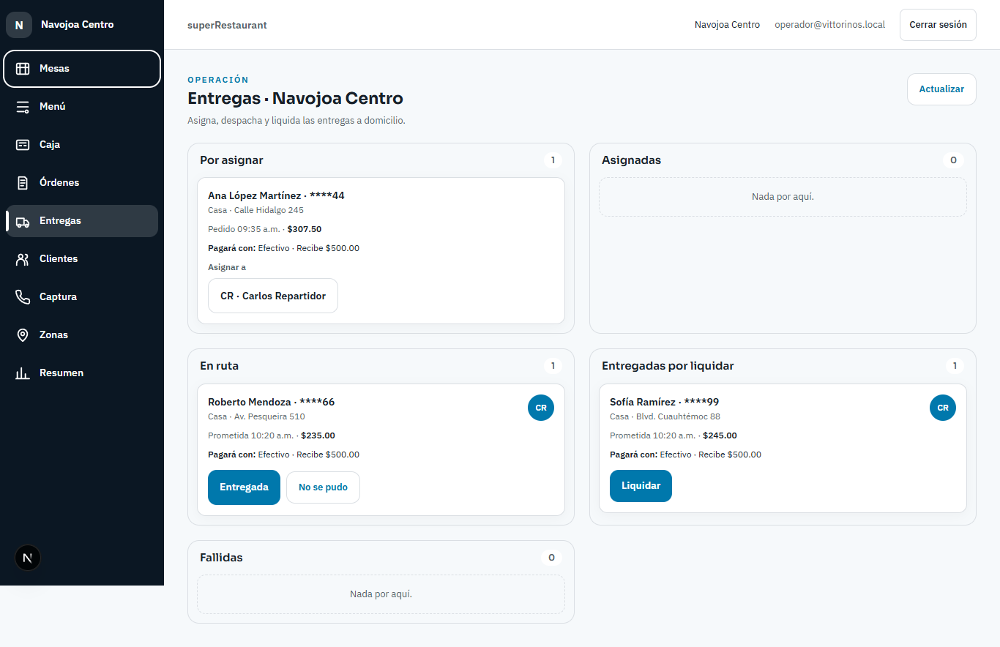

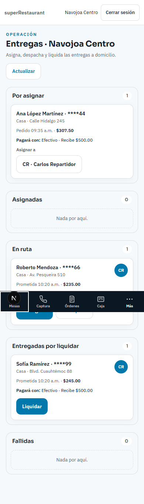

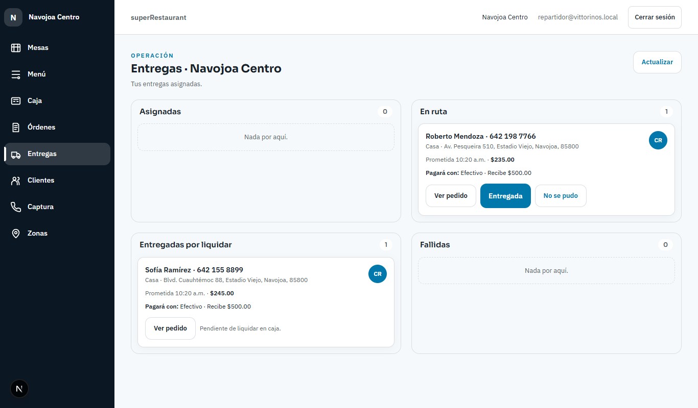

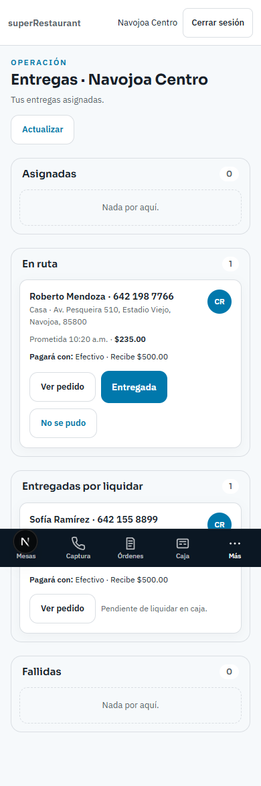

### 6.4. KDS (`apps/kds`)
- **Validado positivamente:** acceso limpio, indicador en vivo `En vivo · kitchen` sobre WebSocket real, 0 overflow X, **0 controles `< 44 px`**, foco de teclado de alto contraste (`3px` amarillo), desglose de mitades (`Mitad A: Armada`, `Mitad B: Hawaiana`, `+ Queso Extra`, `+ Tocino`, `Sin Cebolla`), notas resaltadas en ámbar y transición por lote funcional (`Empezar todo (2)` → `2 líneas iniciadas.` → `EN PREPARACIÓN` + `Listo todo (2)`).

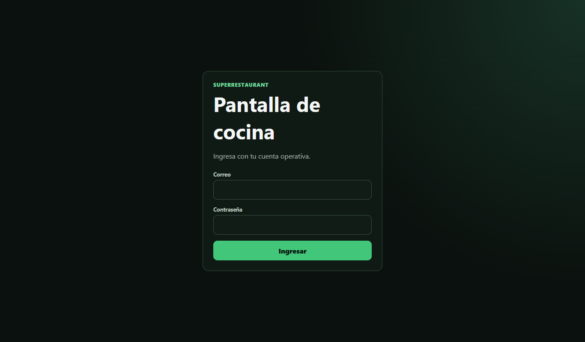

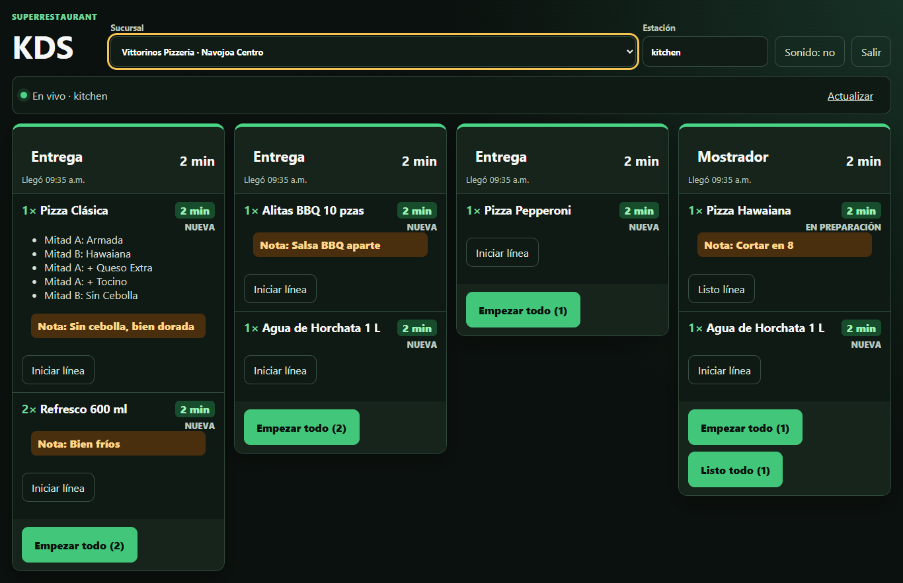

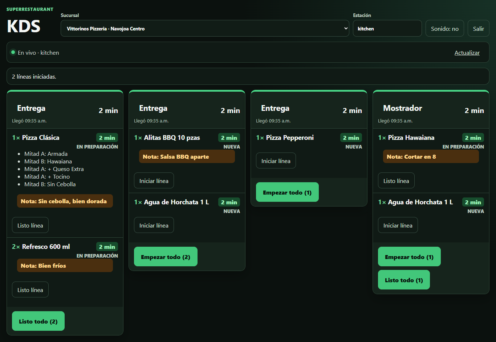

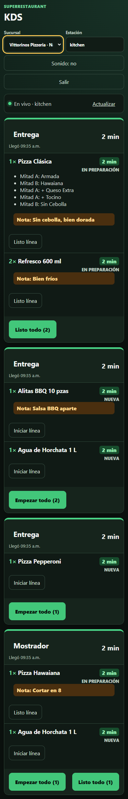

---

## 7. Puertas del alcance y brechas

- **Puertas del alcance (`@super-restaurant/web` y `@super-restaurant/kds`, Node 24.19.0):** `pnpm turbo run lint typecheck test build --filter=@super-restaurant/web --filter=@super-restaurant/kds` → **exit 0 (`16 successful, 16 total`, `55.48s`)**, `pnpm --filter "@super-restaurant/api..." build` → **exit 0 (`4/4`)**, y `git diff --check` limpio.
- **Brechas / fuera de alcance de esta tarea de solo lectura visual:**
  - No se modificó código fuente de `apps/web`, `apps/kds`, `apps/api` ni `packages/shared-types` por restricción explícita de alcance (`Solo docs/agentic/visual-verify-r3*`).
  - Los hallazgos **P1-1** (503 en historial de cliente con mitades) y **P1-2** (overflow `433 px` en Captura móvil) deben corregirse antes de promover Captura y Clientes a `DONE` (§19.6).
  - La modal «Ver pedido» del repartidor en `/app/deliveries` y la interacción de «Validar para esta sucursal» en `/app/customers` pueden ampliarse en la ronda siguiente tras cerrar P1-1 y P1-2.
